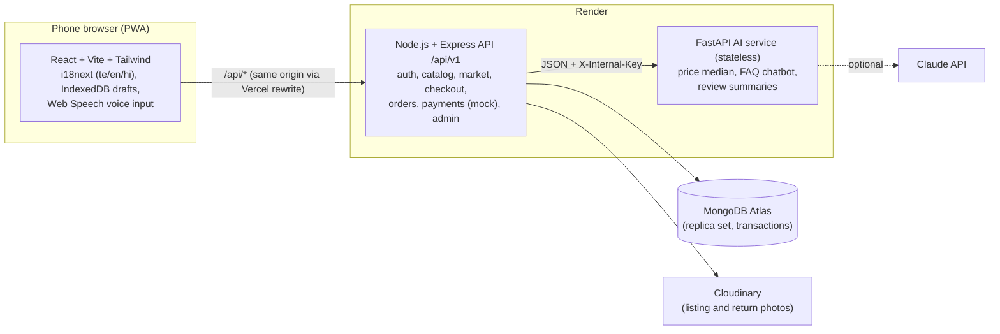

# AgriConnect

A Telugu / English / Hindi marketplace where small farmers in Andhra Pradesh and Telangana sell fresh vegetables and fruit directly to nearby households, and deliver it themselves. Built for farmers who rarely type: big buttons, icons, photos, preset quantities and voice input.

> Live demo: _add your Vercel URL here_ · Demo logins below · Progress: [docs/PROGRESS.md](docs/PROGRESS.md)

  

_(Screenshots: add phone-size captures to `docs/screenshots/`.)_

## Features

**Farmers**
- Phone OTP sign-in, onboarding with village, delivery radius/pincodes, delivery days and fees.
- Sell in three short screens: tap a crop photo, enter quantity and price, publish (own photo optional). Drafts survive a closed app and weak network.
- **Price suggestion**: median of recent sales of the crop in the district, or labelled mandi prices when data is thin.
- Orders: accept or reject, mark out for delivery, confirm handover with the buyer's 4-digit delivery code. Earnings ledger.

**Buyers**
- Product grid (2/3/4 columns) with real crop photos, farmer rating or a New badge, freshness tag and one-tap Add; search, categories and sort by distance, price or rating.
- Only farmers who deliver to the buyer's location are shown, with approximate distance (whole km).
- Multi-farmer cart: one order per farmer, atomic stock reservation, cash on delivery or mock UPI.
- Live order status, delivery code, notifications, verified-purchase reviews, problem reports (returns) with a photo.
- **"What buyers say"**: an AI summary of a farmer's reviews, clearly labelled.

**Everyone**
- **Help chat** with FAQ answers plus live listings; type or speak (Web Speech API, en/te/hi).
- Trust score (average stars, review count, completed orders) with a "New" label instead of a penalty.

**Admin**
- Users (suspend/activate), orders, fraud flags (duplicate address), returns (approve refund or reject). Everything is audit-logged.

## Architecture



Key design points (each has an ADR in [docs/decisions](docs/decisions)):

- **Stock can never oversell.** Checkout runs in one transaction with a conditional `$inc` per item (`availableQuantity >= requested`); a test races 50 buyers for 30 units.
- **Never trust the client.** Prices, fees, totals and stock are recomputed on the server; every route checks role and ownership.
- **Order state machine as data.** `placed → accepted → out_for_delivery → delivered`, plus cancelled/rejected/failed; each change is atomic, audit-logged and notifies the other party.
- **Money in integer paise** and an append-only ledger (sale, platform fee, payout, refund).
- **Honest AI.** Price hints always show source, place and date; chatbot avoids pesticide doses and says when unsure; AI-written text is labelled. Everything works without an LLM key.

## Tech stack

| Part | Stack |
| --- | --- |
| Crop photos | 59 free-licensed Wikimedia Commons photos, credits in [frontend/public/crops/CREDITS.md](frontend/public/crops/CREDITS.md) |
| Frontend | React 19, Vite, Tailwind CSS 4, React Router, i18next, vite-plugin-pwa, idb; Vitest + Testing Library + axe; Playwright smoke test |
| Backend | Node.js 22, Express 5, Mongoose 9, zod, JWT + httpOnly refresh cookie, pino; Jest + supertest + in-memory MongoDB replica set |
| AI service | Python 3.11, FastAPI, Anthropic SDK; pytest, ruff |
| Infra | Vercel, Render (Docker), MongoDB Atlas, Cloudinary, GitHub Actions |

## Run locally

Prerequisites: Node.js 22.9+, Python 3.11+, Docker.

```bash
# 1. MongoDB (single-node replica set)
docker compose up -d

# 2. Backend -> http://localhost:4000/api/v1/health
cd backend && cp .env.example .env && npm install
npm run seed:crops && npm run seed     # demo data; npm run seed:clear removes it
npm run dev

# 3. AI service -> http://localhost:8000/health
cd ai-service && python -m venv .venv
# Windows: .venv\Scripts\activate    macOS/Linux: source .venv/bin/activate
pip install -r requirements-dev.txt
uvicorn app.main:app --reload --port 8000     # optional: set ANTHROPIC_API_KEY in .env

# 4. Frontend -> http://localhost:5173
cd frontend && npm install && npm run dev
```

## Demo walkthrough

Every OTP is `123456` locally (`DEMO_OTP` on the deployed demo).

1. Sign in as farmer **9999900011** (Ramu). Tap **Sell**, add a photo, pick Tomato, check the **price suggestion**, publish.
2. In another browser, sign in as buyer **9999900021** (Padma). Find the tomatoes, add 5 kg to the cart, place the order (cash on delivery).
3. As Ramu, open **Orders**, accept, then **Out for delivery**.
4. As Padma, open the order: note the 4-digit **delivery code**.
5. As Ramu, enter the code to mark it delivered; check **Earnings**.
6. As Padma, leave a review or **report a problem** with a photo; tap **Help** and ask "Is tomato available?" (try the mic).
7. As admin (`npm run seed:admin`), review fraud flags and approve the return.

## Tests

```bash
cd backend && npm run lint && npm test                 # ~330 tests
cd frontend && npm run lint && npm test                # ~150 tests (+ i18n parity)
cd frontend && npm run test:e2e                        # Playwright smoke: list -> order -> accept
cd ai-service && ruff check . && ruff format --check . && pytest
```

CI runs lint and tests for all three on every push ([.github/workflows/ci.yml](.github/workflows/ci.yml)).

## Deploy

Step-by-step with the full environment variable list: [docs/deploy.md](docs/deploy.md) (Vercel + Render blueprint `render.yaml` + Atlas).

## Docs

[Architecture](docs/architecture.md) · [Database](docs/database.md) · [API](docs/api.md) · [Decisions](docs/decisions) · [Learning notes](docs/learn) · [Translation review](docs/translation-review.md)

## Future scope

- **Field agent module**: agents register farmers with OTP consent and list on their behalf, with every action audit-logged and price/quantity changes needing farmer approval (roles and audit log already exist).
- **Real Razorpay UPI**: replace the mock payment provider with Razorpay orders, signature-verified webhooks and gateway refunds (the payment and ledger interfaces are already provider-shaped).
- **Offline retry queue**: queue listing publishes and status updates in IndexedDB and replay them when the network returns (drafts and photos already survive offline).
- **Crop quality image model**: a small CPU image classifier giving a "visual check only (beta)" freshness hint on listing photos, reported with real measured accuracy.
- Real SMS (MSG91 with DLT templates), Telugu/Hindi review by native speakers, and delivery route grouping for farmers.
