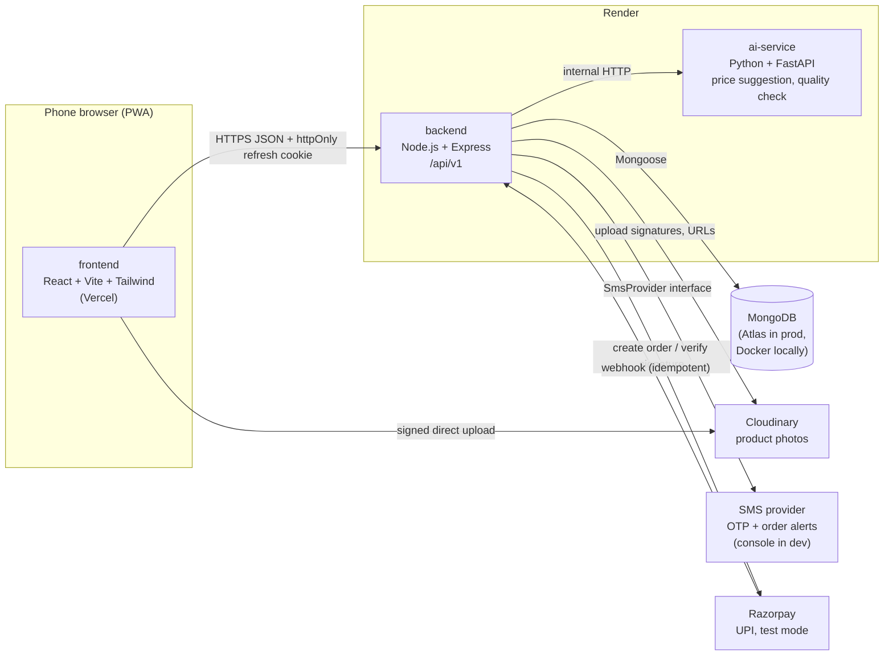
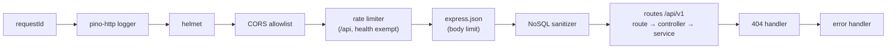

# Architecture

AgriConnect is a monorepo with three deployable services and a handful of managed external services.

## Responsibilities

| Component | Owns | Does not own |
| --- | --- | --- |
| frontend | UI, i18n (te/en/hi), offline drafts in IndexedDB, access token in memory | Prices, totals, stock, authorization (server re-checks all of these) |
| backend | Auth, business rules, orders, inventory, payments ledger, fraud rules, audit log | ML inference |
| ai-service | Price suggestion model, crop visual quality check | User data and authorization (only called by the backend) |
| MongoDB | All persistent state | |

## Backend request pipeline

Every request passes through the same middleware in this order ([backend/src/app.js](../backend/src/app.js)):

- **The request id comes first** so every later log line, including errors, carries it.
- **The rate limiter runs before body parsing** so a flood of large bodies is rejected before the server spends CPU parsing them.
- **The sanitizer runs after parsing**, because it needs the parsed body.
- **Routes validate input with `validate({ params, query, body })`** (zod) before the controller runs.
- **Controllers stay thin and services hold the business logic**, so services can be unit-tested without HTTP.
- **Any thrown or rejected error ends up in the error handler.** Express 5 forwards async errors automatically. The handler turns the error into the standard `{ error: { code, message } }` response.

### Process lifecycle ([backend/src/server.js](../backend/src/server.js))

1. **Startup.** Load and validate config, exiting with a list of bad variables if anything is invalid. Then connect to MongoDB, exiting if that fails. Then listen.
2. **Shutdown on SIGTERM/SIGINT.** Stop accepting connections, let in-flight requests finish, then disconnect MongoDB. If this takes more than 10 s, force the exit.
3. **On an unhandled rejection or uncaught exception,** log at fatal level and run the same shutdown with exit code 1. The host then restarts the process.

## Key decisions so far

- The browser never talks to ai-service directly. The backend calls it, so authentication, rate limits and auditing stay in one place.
- In development the Vite dev server proxies `/api` to the backend so the app is same-origin, matching the cookie setup used in production.
- Local MongoDB runs as a single-node replica set because checkout transactions (Prompt 10) need one.

This file is updated whenever the architecture changes.
