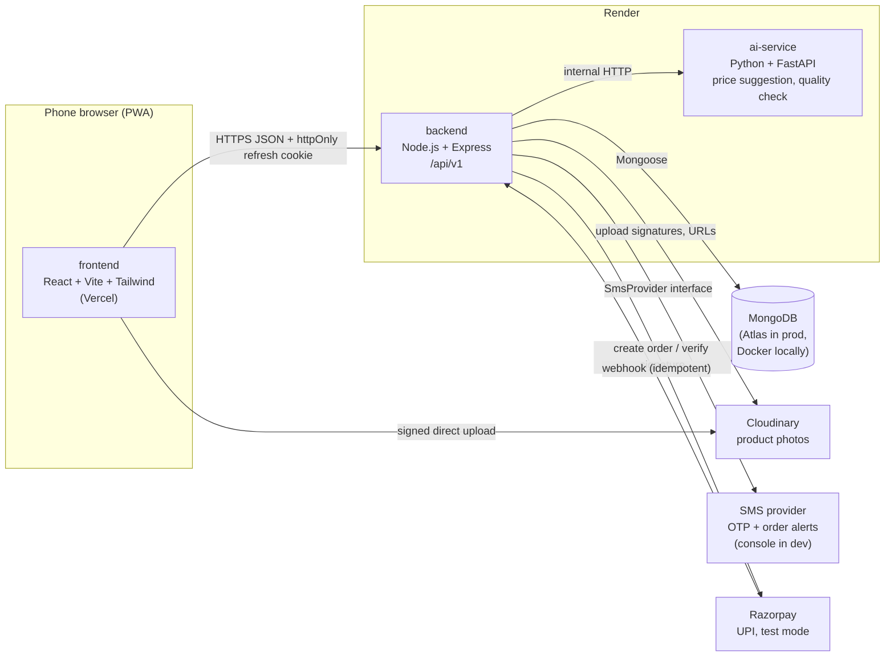
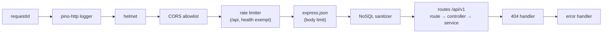
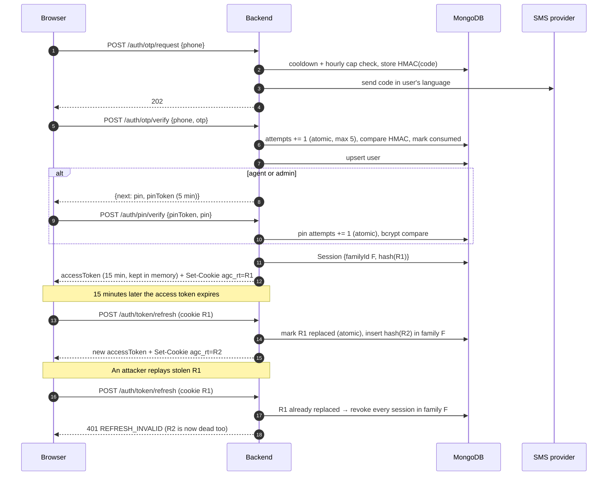
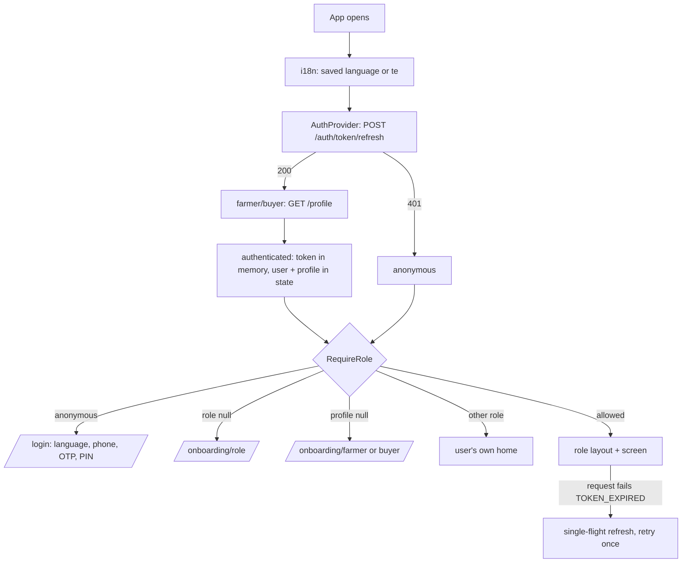

# Architecture

AgriConnect is a monorepo with three deployable services and a handful of managed external services.



## Responsibilities

| Component | Owns | Does not own |
| --- | --- | --- |
| frontend | UI, i18n (te/en/hi), offline drafts in IndexedDB, access token in memory | Prices, totals, stock, authorization (server re-checks all of these) |
| backend | Auth, business rules, orders, inventory, payments ledger, fraud rules, audit log | ML inference |
| ai-service | Price suggestion model, crop visual quality check | User data and authorization (only called by the backend) |
| MongoDB | All persistent state | |

## Backend request pipeline

Every request passes through the same middleware in this order ([backend/src/app.js](../backend/src/app.js)):



- **The request id comes first** so every later log line, including errors, carries it.
- **The rate limiter runs before body parsing** so a flood of large bodies is rejected before the server spends CPU parsing them.
- **The sanitizer runs after parsing**, because it needs the parsed body.
- **Routes validate input with `validate({ params, query, body })`** (zod) before the controller runs.
- **Controllers stay thin and services hold the business logic**, so services can be unit-tested without HTTP.
- **Any thrown or rejected error ends up in the error handler.** Express 5 forwards async errors automatically. The handler turns the error into the standard `{ error: { code, message } }` response.

### Process lifecycle ([backend/src/server.js](../backend/src/server.js))

1. **Startup.** Load and validate config, exiting with a list of bad variables if anything is invalid. Then connect to MongoDB, exiting if that fails. Then listen.
2. **Shutdown on SIGTERM/SIGINT.** Stop accepting connections, let in-flight requests finish, then disconnect MongoDB. If this takes more than 10 s, force the exit.
3. **On an unhandled rejection or uncaught exception,** log at fatal level and run the same shutdown with exit code 1. The host then restarts the process.

## Authentication

### Same-origin in every environment

The browser always calls `/api/...` on the page's own origin, so it treats the refresh cookie as first-party and `SameSite=Strict` works:

| Environment | Browser calls | Forwarded to |
| --- | --- | --- |
| Development | `http://localhost:5173/api/*` | Vite proxy → `http://localhost:4000` |
| Production | `https://<app>.vercel.app/api/*` | Vercel rewrite ([frontend/vercel.json](../frontend/vercel.json)) → Render backend |

The Render URL in `vercel.json` is a placeholder until the backend is deployed (Prompt 24). With the rewrite, requests pass through two proxies (Vercel, then Render), so `TRUST_PROXY` will likely be 2. This must be confirmed at deploy time.

### Login, refresh and reuse detection



### What each request trusts

- **Access token (JWT, HS256):** proves *who* the caller is, for up to 15 minutes.
- **`requireAuth` then loads the user from MongoDB on every request.** Suspension, role changes and logout-all therefore take effect immediately, and role checks use the database role, not the token's.
- **Refresh token:** a random 256-bit value, stored only as a SHA-256 hash, sent only to `/api/v1/auth/*`.

## Frontend structure

```
frontend/src/
  main.jsx            loads i18n + CSS, renders <App/> in StrictMode
  App.jsx             AuthProvider > ToastProvider > RouterProvider
  app/routes.jsx      single route table (browser router in the app, memory router in tests)
  auth/               AuthProvider (session state + OTP/PIN/role/logout actions), RequireRole guard, role home paths
  lib/api.js          fetch client: token in memory, ApiError, single-flight refresh + retry
  i18n/               i18next setup, locales/{te,en,hi}/{common,devui}.json
  components/ui/      design system (BigButton, IconTile, PageHeader, QuantityStepper, PresetChips,
                      Toast, Skeleton, EmptyState, ErrorState, BottomNav, ConfirmSheet/BottomSheet)
  layouts/            RootLayout (skip link, offline banner), PublicLayout, RoleLayout (+ bottom menu)
  pages/              Welcome, role homes and placeholders, NotFound, DevUi gallery
  hooks/              useApiRequest (cancellable loading), useOnlineStatus
```



## Key decisions so far

- The browser never talks to ai-service directly. The backend calls it, so authentication, rate limits and auditing stay in one place.
- In development the Vite dev server proxies `/api` to the backend, and in production a Vercel rewrite does the same. Either way the app is same-origin, which lets the refresh cookie use `SameSite=Strict` (ADR 0003).
- Local MongoDB runs as a single-node replica set because checkout transactions (Prompt 10) need one.

This file is updated whenever the architecture changes.
