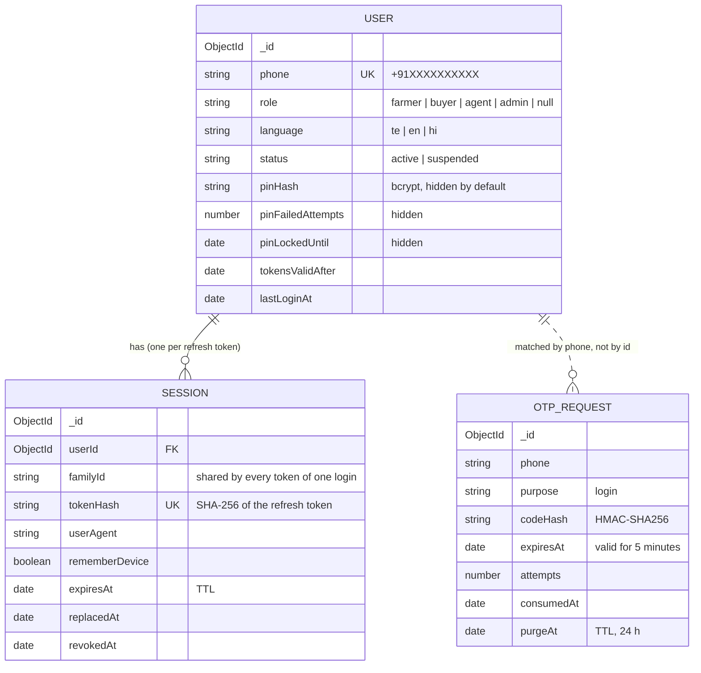

# Database

MongoDB with Mongoose. This file matches the models in [backend/src/models/](../backend/src/models/). The marketplace collections (farmers, crops, products, orders, …) arrive in Prompt 3.

## Local setup

`docker compose up -d` starts MongoDB 7 as a single-node replica set (`rs0`) on port 27017. Connection string:

```
mongodb://localhost:27017/agriconnect?replicaSet=rs0
```

Tests use an in-memory replica set instead (MongoDB 7.0.14), with one database per test file.

## ER diagram (so far)



## Collections

### `users` ([User.js](../backend/src/models/User.js))

One document per phone number, for every role.

| Field | Type | Notes |
| --- | --- | --- |
| `phone` | string, unique | Normalised `+91XXXXXXXXXX`. Validated by regex. |
| `role` | `farmer` \| `buyer` \| `agent` \| `admin` \| `null` | `null` until a new user picks farmer or buyer. agent/admin are only set by an admin or the seed script. |
| `language` | `te` \| `en` \| `hi` | Default `te`. Used for SMS. |
| `status` | `active` \| `suspended` | Suspended users cannot log in or use existing tokens. |
| `pinHash` | string, `select: false` | bcrypt (cost 10). Agents and admins only. |
| `pinFailedAttempts`, `pinLockedUntil` | number, date, `select: false` | PIN lockout: 5 attempts, then 15 minutes. |
| `tokensValidAfter` | date \| null | Set by logout-all. Access tokens with an earlier `issuedAtMs` are rejected. |
| `lastLoginAt` | date \| null | |
| `createdAt`, `updatedAt` | date | Mongoose timestamps. |

**Indexes:**
- `{ phone: 1 }` unique.

### `otprequests` ([OtpRequest.js](../backend/src/models/OtpRequest.js))

| Field | Type | Notes |
| --- | --- | --- |
| `phone` | string | Normalised. |
| `purpose` | `login` | More purposes (agent consent) come in Prompt 15. |
| `codeHash` | string | `HMAC-SHA256(OTP_HMAC_SECRET, phone:purpose:code)`. The code itself is never stored. |
| `expiresAt` | date | `createdAt` + 5 minutes. |
| `attempts` | number | Incremented atomically before each comparison; max 5. |
| `consumedAt` | date \| null | Set once on success; makes the code single-use. |
| `purgeAt` | date | `createdAt` + 24 h; the TTL index deletes the row then. Kept past expiry so the 5-per-hour cap can count recent codes. |
| `createdAt` | date | |

**Indexes:**
- `{ phone: 1, purpose: 1, createdAt: -1 }`: serves both "latest code for this phone" and "codes in the last hour".
- `{ purgeAt: 1 }` with `expireAfterSeconds: 0`: TTL.

### `sessions` ([Session.js](../backend/src/models/Session.js))

One document per refresh token. Rotation adds a new document to the same family and marks the old one `replacedAt`.

| Field | Type | Notes |
| --- | --- | --- |
| `userId` | ObjectId → users | |
| `familyId` | string (UUID) | Shared by every token descending from one login. Reuse of a replaced token revokes the whole family. |
| `tokenHash` | string, unique | SHA-256 of the 256-bit random token. |
| `userAgent` | string (≤200) | For a future "your devices" screen. |
| `rememberDevice` | boolean | `false`: browser-session cookie and at most 1 day. |
| `expiresAt` | date | 30 days (or 1 day) from issue; TTL deletes the row. |
| `replacedAt` | date \| null | Set when this token is rotated. |
| `revokedAt` | date \| null | Set on logout, logout-all, reuse detection, or a suspended user. |
| `createdAt` | date | |

**Indexes:**
- `{ tokenHash: 1 }` unique.
- `{ userId: 1, revokedAt: 1 }` for logout-all.
- `{ familyId: 1 }` for family revocation.
- `{ expiresAt: 1 }` with `expireAfterSeconds: 0`: TTL.
