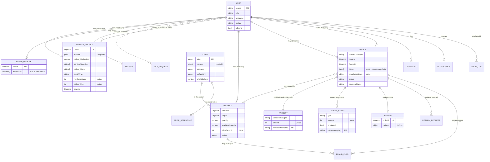

# Database

MongoDB with Mongoose. This file matches the models in [backend/src/models/](../backend/src/models/). Change both together.

## Local setup

`docker compose up -d` starts MongoDB 7 as a single-node replica set (`rs0`) on port 27017. Connection string:

```
mongodb://localhost:27017/agriconnect?replicaSet=rs0
```

| Command (in `backend/`) | What it does |
| --- | --- |
| `npm run db:indexes` | Builds every declared index and drops undeclared ones (`syncAllIndexes`). |
| `npm run seed:crops` | Upserts the 59-crop catalog. Writes only new or changed crops. |
| `npm run seed:admin` | Creates the first admin from `SEED_ADMIN_PHONE`. Add `-- --force` to promote an existing user. |
| `npm run seed:demo` | Replaces all `isDemo` records with a fresh demo marketplace. Refuses in production unless `ALLOW_DEMO_SEED=true`. |

Every seed task syncs indexes first. Tests use an in-memory replica set (MongoDB 7.0.14), with one database per test file.

## Conventions

- **Money is integer paise** (₹1 = 100 paise). Every money field uses the `paise()` helper ([shared.js](../backend/src/models/shared.js)), which rejects fractions. Totals come from one function, [pricing.service.js](../backend/src/services/pricing.service.js). This means no floating-point drift. ₹42.50 is stored as `4250`.
- **Locations are GeoJSON points `[longitude, latitude]`**, validated to lie inside India's bounding box. The service is India-only, and a range check alone would accept a swapped pair (latitude 80.6 is valid on Earth).
- **Snapshots, not live references, wherever history must not change.** An order copies the crop name (en/te/hi), unit, price per unit and delivery address at checkout.
- **Demo records carry `isDemo: true`** (on users, profiles, products and orders), so they can be found, shown with a label and removed without touching real data.
- **Append-only collections:** `ledgerentries` and `auditlogs` throw on update or delete. Corrections are new entries.
- **Sensitive fields use `select: false`:** `users.pinHash`, `users.pinFailedAttempts`, `users.pinLockedUntil`, `orders.deliveryOtpHash`, `orders.deliveryOtpAttempts`.

## ER diagram



Session and OtpRequest are documented under [Authentication collections](#authentication-collections).

## Collections

### `farmerprofiles` ([FarmerProfile.js](../backend/src/models/FarmerProfile.js))

One per farmer user. It holds where they are and how they deliver.

| Field | Type | Notes |
| --- | --- | --- |
| `userId` | ObjectId → users, unique | |
| `name`, `village`, `mandal`, `district` | string (≤80) | |
| `state` | `Andhra Pradesh` \| `Telangana` | |
| `pincode` | string `^[1-9]\d{5}$` | |
| `location` | Point, optional | **Exact farm location: never sent to buyers before an order is accepted.** Optional because a farmer may deny location permission. |
| `deliveryRadiusKm` | number 0–50, default 5 | |
| `servicePincodes` | string[] (≤30) | Pincode-based coverage; needed when there is no location. |
| `deliveryDays` | `mon`…`sun`[], default mon/wed/fri | At least one. |
| `cutoffTime` | `HH:mm`, default `18:00` | Asia/Kolkata. Later orders go to the next delivery day. |
| `minOrderValue`, `deliveryFee` | paise, default ₹100 and ₹20 | |
| `verificationLevel` | `phone_verified` \| `agent_verified` \| `trusted_seller` | Badges (Prompt 16). |
| `agentId` | ObjectId → users \| null | The agent who registered or assists this farmer. |

**Indexes:**
- `{ userId: 1 }` unique.
- `{ location: '2dsphere' }`.
- `{ servicePincodes: 1 }`.
- `{ agentId: 1 }`.

### `buyerprofiles` ([BuyerProfile.js](../backend/src/models/BuyerProfile.js))

| Field | Type | Notes |
| --- | --- | --- |
| `userId` | ObjectId → users, unique | |
| `name` | string | |
| `addresses[]` | max 5, at most one `isDefault` | `label`, `houseAndStreet`, `landmark` (required), `area`, `pincode` (required), optional `location` Point. |

**Indexes:**
- `{ userId: 1 }` unique.
- `{ 'addresses.pincode': 1, 'addresses.landmark': 1 }` (the "many accounts at one address" fraud rule).

### `crops` ([Crop.js](../backend/src/models/Crop.js))

The shared catalog. Products point at it.

| Field | Type | Notes |
| --- | --- | --- |
| `slug` | string, unique | Stable key used by seeds (`tomato`, `green-chilli`). |
| `names` | `{ en, te, hi }`, all required | te/hi under review ([translation-review.md](translation-review.md)). |
| `category` | `vegetable` \| `fruit` \| `leafy` \| `other` | |
| `defaultUnit`, `allowedUnits` | `kg` \| `dozen` \| `bunch` \| `piece` | `allowedUnits` must include `defaultUnit`. |
| `quantityPresets` | number[] | One-tap stock amounts in the listing flow. |
| `quantityStep` | number ≥ 0.25 | Smallest change a buyer can make (0.5 kg, 1 bunch, 5 lemons). |
| `shelfLifeDays` | number | Conservative; used to warn about or expire old listings (Prompt 8). |
| `icon` | string | Emoji for now; may become an asset path. |
| `isActive` | boolean | Hide a crop without deleting it. |

**Indexes:**
- `{ slug: 1 }` unique.
- `{ category: 1, isActive: 1 }`.

### `products` ([Product.js](../backend/src/models/Product.js))

One listing by one farmer.

| Field | Type | Notes |
| --- | --- | --- |
| `farmerId` | ObjectId → users | Owner (checked by `requireOwnership`). |
| `cropId` | ObjectId → crops | |
| `photos[]` | ≤5 of `{ url, thumbnailUrl, capturedAt, perceptualHash }` | Upload pipeline in Prompt 7. |
| `quantity` | number ≥ 0 | What was listed. |
| `availableQuantity` | number, 0 ≤ x ≤ quantity | **Decremented only by a conditional atomic update at checkout** (Prompt 10). Restored on cancel, reject or failure. |
| `unit` | unit enum | |
| `pricePerUnit` | paise | |
| `harvestDate` | date | |
| `status` | `available` \| `out_of_stock` \| `paused` \| `removed` | `removed` is a soft delete. |
| `aiResultId` | ObjectId → AIResult \| null | Prompt 19. |
| `createdByAgentId` | ObjectId → users \| null | Prompt 15. |

**Indexes:**
- `{ farmerId: 1, status: 1, updatedAt: -1 }` (My Products).
- `{ cropId: 1, status: 1 }`.
- `{ status: 1, harvestDate: -1 }`.

Products have **no location of their own**. Nearby search (Prompt 9) will run `$geoNear` on `farmerprofiles` and then join products. Whether to denormalise the location onto products for speed is decided there.

### `orders` ([Order.js](../backend/src/models/Order.js))

One per farmer per checkout.

| Field | Type | Notes |
| --- | --- | --- |
| `checkoutGroupId` | string (UUID) | Shared by the orders of one multi-farmer checkout. |
| `buyerId`, `farmerId` | ObjectId → users | |
| `items[]` | ≥1 of `{ productId, cropId, cropName{en,te,hi}, unit, quantity, pricePerUnit, lineTotal }` | **Snapshots** taken at checkout. |
| `delivery` | `{ slotDate, address{ name, houseAndStreet, landmark, area, pincode, location }, fee }` | Address is a snapshot too. |
| `priceBreakdown` | `{ itemsTotal, deliveryFee, platformFee, buyerTotal, farmerEarnings }` paise | From `computeOrderPricing`. `buyerTotal = itemsTotal + deliveryFee`; `farmerEarnings = buyerTotal − platformFee`. |
| `paymentMethod` | `cod` \| `upi` | |
| `paymentStatus` | `pending` \| `held` \| `paid` \| `failed` \| `refunded` \| `partially_refunded` | `held` = UPI received, not yet released to the farmer. |
| `status` | `placed` → `accepted` → `out_for_delivery` → `delivered`; or `cancelled` \| `rejected` \| `failed` | State machine in Prompt 11. |
| `statusHistory[]` | `{ status, at, byUserId, reason }` | Append on every change. |
| `deliveryOtpHash`, `deliveryOtpAttempts` | hidden | 4-digit handover code (Prompt 11). |
| `deliveredAt` | date \| null | Starts the return window. |

**Indexes:**
- `{ buyerId: 1, createdAt: -1 }`.
- `{ farmerId: 1, status: 1, createdAt: -1 }`.
- `{ checkoutGroupId: 1 }`.
- `{ status: 1, 'delivery.slotDate': 1 }`.

### `payments` ([Payment.js](../backend/src/models/Payment.js))

One per checkout (a UPI payment covers all farmer orders in the group).

**Fields:**
- `checkoutGroupId`, `orderIds[]`, `buyerId`
- `method`
- `amount` (paise)
- `status`: `created` \| `captured` \| `failed` \| `refunded`
- `provider`: `razorpay` \| `cod`
- `providerOrderId`, `providerPaymentId`
- `processedEventIds[]`: webhook events already applied, so replays are ignored.

**Indexes:**
- `{ checkoutGroupId: 1 }`.
- `{ providerOrderId: 1 }` unique sparse.
- `{ providerPaymentId: 1 }` unique sparse.

### `ledgerentries` ([LedgerEntry.js](../backend/src/models/LedgerEntry.js)), append-only

**Fields:**
- `type`: `buyer_payment` \| `platform_fee` \| `farmer_payout` \| `refund` \| `buyer_credit`
- `userId` (null = platform), `orderId`
- `direction`: `credit` \| `debit`
- `amount` (paise)
- `simulated`: farmer payouts are simulated in the MVP.
- `description`
- **`idempotencyKey`** (unique), for example `payout:<orderId>`. A retried webhook or job cannot create a second entry.

**Indexes:**
- `{ idempotencyKey: 1 }` unique.
- `{ userId: 1, createdAt: -1 }`.
- `{ orderId: 1 }`.

### `reviews` ([Review.js](../backend/src/models/Review.js))

**Fields:**
- `orderId` (unique: **one review per order**), `buyerId`, `farmerId`.
- `ratings`: `{ quality, freshness, packaging, delivery }`, integers 1–5.
- `comment` (≤500).
- `farmerResponse { text, at }`.
- `appeal { status: none|pending|upheld|rejected, reason }`.
- `isHidden`: hidden reviews stay stored but are not shown or scored.

The service (Prompt 16) also checks that the order is `delivered`.

**Indexes:**
- `{ orderId: 1 }` unique.
- `{ farmerId: 1, isHidden: 1, createdAt: -1 }`.

### `returnrequests` ([ReturnRequest.js](../backend/src/models/ReturnRequest.js))

**Fields:**
- `orderId`, `buyerId`, `farmerId`
- `items[] { productId, quantity }`
- `reason`: `damaged` \| `rotten` \| `wrong_item` \| `underweight`
- `note`
- `photos` (≤3)
- `evidence { listingPhotoUrls, deliveredAt, aiResultId }`, attached automatically.
- `status`: `open` \| `farmer_accepted` \| `farmer_countered` \| `resolved`
- `farmerResponse { decision, note, photos, at }`
- `resolution { outcome: partial_refund|replacement|credit|rejected, amount, note, resolvedBy, at }`

The allowed reasons and the time window come from AppConfig.

**Indexes:**
- `{ orderId: 1 }`.
- `{ status: 1, createdAt: 1 }`.
- `{ buyerId: 1, createdAt: -1 }`.
- `{ farmerId: 1, status: 1 }`.

### `complaints` ([Complaint.js](../backend/src/models/Complaint.js))

For non-order issues.

**Fields:**
- `userId`
- `category`: `app_problem` \| `payment` \| `behaviour` \| `listing` \| `other`
- `orderId?`
- `message` (≤1000)
- `status`: `open` \| `in_progress` \| `resolved`
- `assignedTo`, `resolutionNote`

**Indexes:**
- `{ status: 1, createdAt: 1 }`.
- `{ userId: 1, createdAt: -1 }`.

### `notifications` ([Notification.js](../backend/src/models/Notification.js))

**Fields:**
- `userId`
- `templateKey` + `params`. The text is rendered in the reader's *current* language.
- `channel`: `in_app` \| `sms` \| `push`
- `link`
- `readAt`
- `expiresAt` (90 days)

**Indexes:**
- `{ userId: 1, readAt: 1, createdAt: -1 }` (inbox and unread count).
- TTL on `expiresAt`.

### `auditlogs` ([AuditLog.js](../backend/src/models/AuditLog.js)), append-only

**Fields:**
- `actorId` (null = system), `actorRole` (`farmer|buyer|agent|admin|system`)
- `action`: `entity.verb`, for example `order.status_changed`, `user.role_granted`, `app_config.updated`.
- `entityType`, `entityId`
- `before`, `after`
- `reason`, `requestId`

Written only by services via `recordAudit()`. Pass a Mongoose `session` to write the entry in the same transaction as the change.

**Indexes:**
- `{ entityType: 1, entityId: 1, createdAt: -1 }`.
- `{ actorId: 1, createdAt: -1 }`.
- `{ action: 1, createdAt: -1 }`.

### `fraudflags` ([FraudFlag.js](../backend/src/models/FraudFlag.js))

**Fields:**
- `subjectType`: `order` \| `product` \| `user`
- `subjectId`
- `ruleId`
- `severity`: `low` \| `medium` \| `high`
- `action`: `allow` \| `require_confirmation` \| `restrict_cod` \| `block` \| `admin_review`
- `evidence`: the numbers the rule saw.
- `status`: `open` \| `resolved` \| `dismissed`
- `resolvedBy`, `resolutionNote`

**Indexes:**
- `{ status: 1, severity: 1, createdAt: 1 }` (review queue).
- `{ subjectType: 1, subjectId: 1 }`.

### `pricereferences` ([PriceReference.js](../backend/src/models/PriceReference.js))

One published mandi price row.

**Fields:**
- `cropId?`
- `commodity`, `variety`, `market`, `district`, `state`
- `priceUnit`: `quintal` \| `kg`
- `minPrice`, `modalPrice`, `maxPrice` (paise per `priceUnit`)
- `date`
- `source`: `agmarknet` \| `sample`. The sample fallback is always labelled.
- `ingestedAt`

**Indexes:**
- `{ source, commodity, variety, market, date }` unique: re-running the ingestion cannot duplicate rows.
- `{ cropId: 1, district: 1, date: -1 }`.
- `{ cropId: 1, state: 1, date: -1 }`.

### `appconfigs` ([AppConfig.js](../backend/src/models/AppConfig.js))

Only **overrides** are stored: `{ key (unique), value, updatedBy }`. Defaults, descriptions and validation live in [appConfig.service.js](../backend/src/services/appConfig.service.js). Every change is validated against the key's zod schema and audited.

| Key | Default | Meaning |
| --- | --- | --- |
| `codCapNewBuyer` | 50000 (₹500) | Max COD order value for a "new" buyer |
| `newBuyerDeliveredOrders` | 3 | Delivered orders after which a buyer is no longer new |
| `maxActiveCodOrders` | 2 | Open COD orders allowed at once |
| `codBlockAfterFailedDeliveries` | 2 | Failed/refused COD deliveries before COD is restricted |
| `maxOrdersPerHourPerPhone` / `PerDevice` / `PerIp` | 5 / 5 / 10 | Order velocity limits |
| `maxAccountsPerAddress` | 3 | Buyer accounts at one address before a flag |
| `returnWindowHours` | 4 | Hours after delivery to report a problem |
| `returnReasons` | damaged, rotten, wrong_item, underweight | Reasons offered to buyers |
| `platformFeePercent` | 0 | Commission on produce, deducted from farmer earnings |
| `mandiCommissionPercentEstimate` | 10 | Only for the labelled "vs mandi" estimate |
| `priceStaleAfterDays` | 7 | Mandi price age that triggers a warning |
| `lowStockPercent` | 20 | A listing is "running low" when what is left is at or below this % of what was listed |
| `agentListingsNeedFarmerApproval` | true | Agent-created listings wait for farmer confirmation |

## Authentication collections

### `users` ([User.js](../backend/src/models/User.js))

| Field | Type | Notes |
| --- | --- | --- |
| `phone` | string, unique | Normalised `+91XXXXXXXXXX`. |
| `role` | `farmer` \| `buyer` \| `agent` \| `admin` \| `null` | `null` until a new user picks farmer or buyer. agent/admin are only set by an admin or the seed script. |
| `language` | `te` \| `en` \| `hi` | Default `te`. |
| `status` | `active` \| `suspended` | |
| `pinHash`, `pinFailedAttempts`, `pinLockedUntil` | hidden | bcrypt PIN for agents and admins; 5 tries, then 15 minutes. |
| `tokensValidAfter` | date \| null | Set by logout-all. |
| `lastLoginAt` | date \| null | |
| `isDemo` | boolean | Set only by `seed:demo`. |

**Indexes:**
- `{ phone: 1 }` unique.

### `otprequests` ([OtpRequest.js](../backend/src/models/OtpRequest.js))

**Fields:**
- `phone`, `purpose` (`login`)
- `codeHash`: HMAC-SHA256 with `OTP_HMAC_SECRET`.
- `expiresAt` (+5 min)
- `attempts`: max 5, incremented atomically before comparing.
- `consumedAt`
- `purgeAt` (+24 h, TTL)

**Indexes:**
- `{ phone: 1, purpose: 1, createdAt: -1 }`.
- TTL on `purgeAt`.

### `sessions` ([Session.js](../backend/src/models/Session.js))

One document per refresh token.

**Fields:**
- `userId`
- `familyId`: shared by all tokens of one login.
- `tokenHash` (SHA-256, unique)
- `userAgent`, `rememberDevice`
- `expiresAt` (TTL)
- `replacedAt`, `revokedAt`

**Indexes:**
- `{ tokenHash: 1 }` unique.
- `{ userId: 1, revokedAt: 1 }`.
- `{ familyId: 1 }`.
- TTL on `expiresAt`.

## Who may read and write what

Data access is enforced in services and routes (`requireAuth`, `requireRole`, `requireOwnership`). It is never left to the client. The matrix below is the contract that later prompts implement; "own" means `requireOwnership` on the listed field.

| Collection | Farmer | Buyer | Agent | Admin | System only |
| --- | --- | --- | --- | --- | --- |
| users | read/update own language | same | same | read all; suspend; grant agent/admin | create on OTP verify |
| farmerprofiles | read/update own (not `verificationLevel`, `agentId`) | read public fields of farmers who deliver to them: name, village, **approximate** distance; no exact location until an order is accepted | create for a farmer with OTP consent; update assisted farmers (audited) | read/update all (audited) | |
| buyerprofiles | name + delivery address of their own accepted orders, via the order snapshot | read/update own | none | read all | |
| crops | read | read | read | create/update | seed |
| products | create/update/pause/remove own | read `available` ones near them | create for assisted farmers as `pending approval` (audited) | read all; remove (audited) | stock changes at checkout and cancel |
| orders | read own (`farmerId`); accept/reject/deliver | create via checkout; read own (`buyerId`); cancel before acceptance | help with assisted farmers' orders (audited) | read all; intervene (audited) | |
| payments, ledgerentries | read own earnings | read own payments | none | read all | write (webhooks, delivery confirmation) |
| reviews | read own; respond; appeal | create once per delivered order; read | read | hide or uphold appeals (audited) | |
| returnrequests | read own; accept/counter | create within window; read own | none | resolve (audited, ledger entry) | |
| complaints | create/read own | create/read own | create/read own | read all; resolve | |
| notifications | read/mark own | read/mark own | read/mark own | read/mark own | create |
| fraudflags | none | none | none | read; resolve (audited) | create (rule engine) |
| pricereferences | read | read | read | read | ingestion job |
| appconfigs | none | none | none | read; update via `setAppConfig` (validated, audited) | |
| auditlogs | none | none | own actions | read all | append only |
| otprequests, sessions | none | none | none | none | auth service only |
